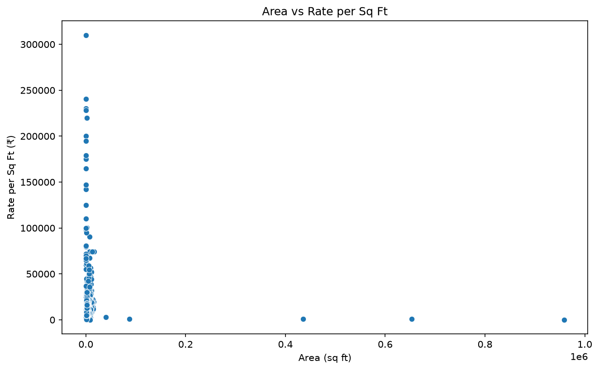

# Gurgaon Real Estate Price Analysis (Python)

Data cleaning and exploratory analysis of 14,000+ property listings using Python.

## Objective
To understand what drives property prices: location, status, RERA approval,
size, property type and builder.

## Dataset
- Property listings CSV: 19,515 rows and 12 columns
- After removing 5,292 duplicates: 14,223 listings
- Columns include price, area, rate per sq ft, locality, status, RERA approval,
  BHK count, flat type and company name

## Tools Used
- Python, Pandas, Matplotlib, Seaborn

## What I Did
1. Standardized column names and removed duplicates
2. Converted price, area and rate per sq ft from text to numeric
3. Cleaned the categorical columns (status, RERA approval, flat type)
4. Answered 10 business questions with Pandas
5. Visualized area vs rate per sq ft with a scatter plot

## Key Insights
- Costliest listing: a 6 BHK apartment in DLF Camellias, Sector 42 (₹122.63 crore).
- Sector 42 has the highest average rate per sq ft (about ₹55,989).
- Ready-to-move properties cost more on average than under-construction ones.
- RERA-approved properties do not show a price premium in this data.
- Area has only a weak link with price, and almost none with rate per sq ft.
- Villas have the highest rate per sq ft, followed by apartments.

## Known Data Issues
- Some BHK counts look incorrect (for example 99 and 114).
- Some company names contain typos.

## Files
- `main.py` – cleaning and analysis code
- `data.csv` – dataset
- `area_vs_rate.png` – scatter plot

## Author
**Sikandar Khan**, aspiring Data Analyst, India

🔗 [LinkedIn](https://www.linkedin.com/in/sikandar-khan-5ba465422/)
💻 [GitHub](https://github.com/sikandar-data-analyst)
📧 sikandarkhankhan980@gmail.com
